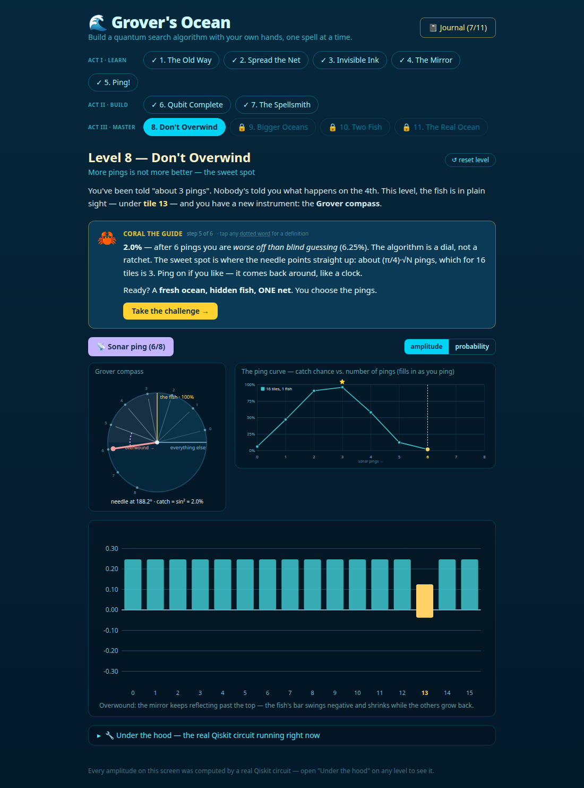
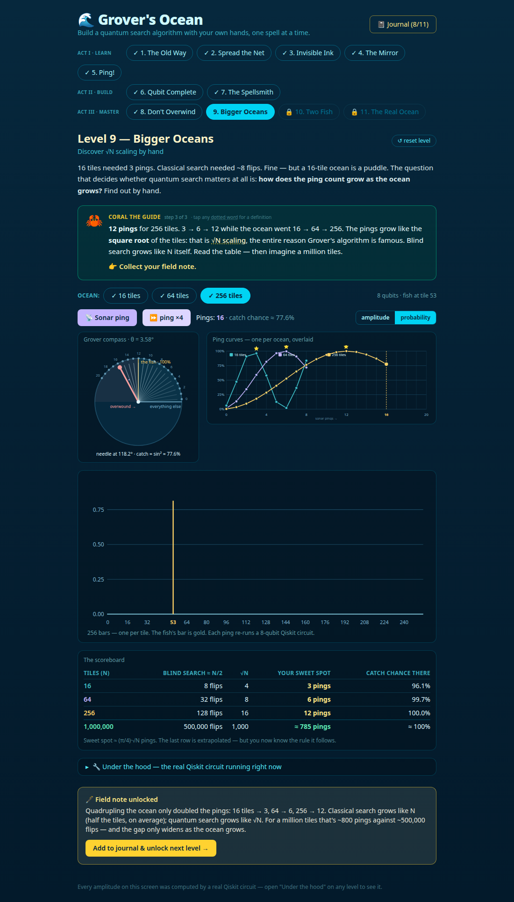
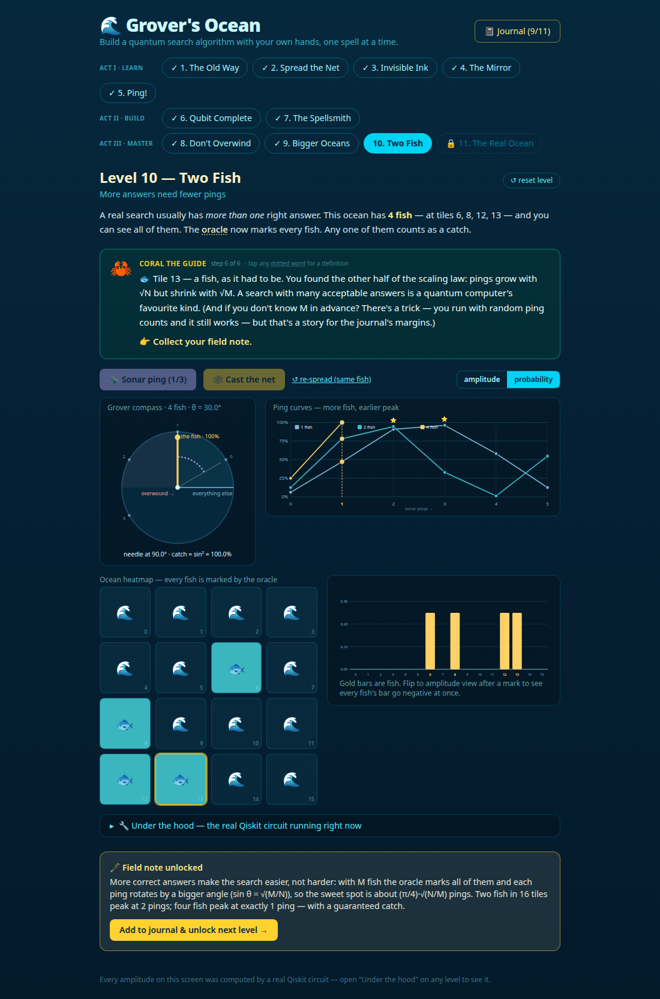
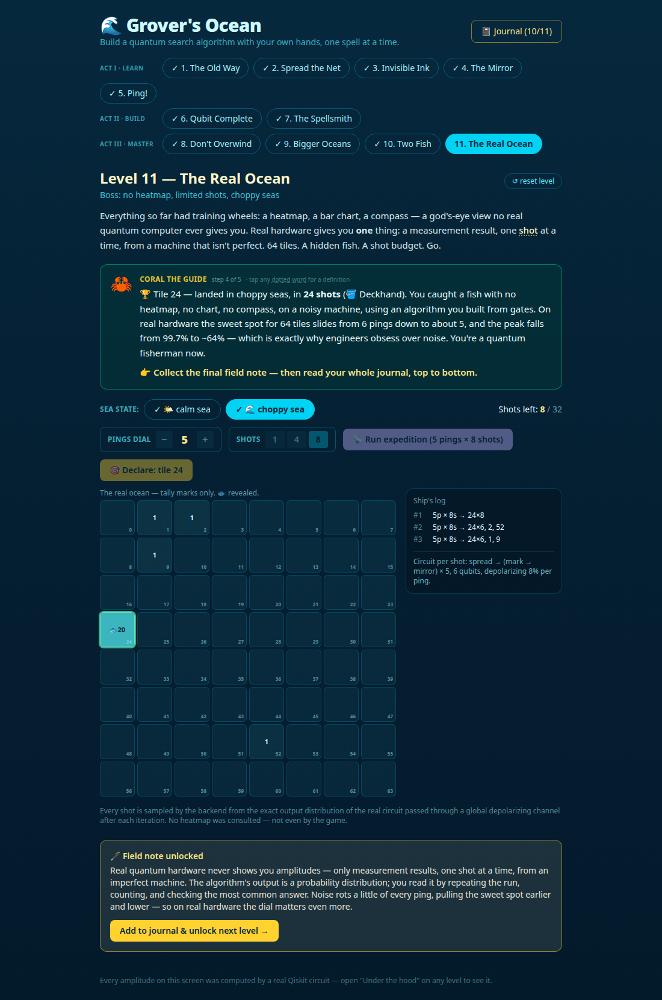

# 🌊 Grover's Ocean

**A playable curriculum for Grover's quantum search algorithm.** Each level
isolates one conceptual ingredient; by Level 5 the player has assembled the
whole algorithm themselves out of spells they understand, by Level 7 they
have forged those spells from raw gates, and by Level 11 they have landed a
fish on a noisy machine with nothing but measurement tallies.

Built for the **Quantum Unlocked** track ("teach a hard topic through a demo,
visualization, or GUI") at the Qollab × IonQ quantum hackathon, Oct 9–11 2026.
MIT licensed. Everything here was written inside the build window — see
[Hackathon notes](#hackathon-notes) for the disclosure and
[`SUBMISSION.md`](SUBMISSION.md) for the submission text and video narration.

<p align="center">
  
  
</p>
<p align="center">
  
  
</p>

## Run it on Qollab

The **whole game runs on Qollab** as a JS/Qiskit project: the React build
mounts in the page, and `ocean/quantum.py` (a verbatim copy of the backend)
runs in Qollab's in-browser Python, so every amplitude is still a real
Qiskit circuit. The boss level's **☁️ Cast on IonQ** button sends one
measured Grover circuit as one job to the backend chosen in Select QPU.

```bash
./qollab/build.sh            # builds frontend/ with relative paths and writes
                             # ~/Desktop/Grovers-Ocean-Qollab.zip (≈100 KB)
```

Upload that zip as the Qollab project, press **Run**, pick a backend, play.
Layout: `index.html` + `main.js` (entry) + `host.js` (answers the game's API
in-page, enforces one IonQ job per Run) + `assets/app.js` + `ocean/`
(`quantum.py`, `bridge.py`). See `qollab/README.md` — it is the project page.

### IonQ in the local game too

```bash
pip install qiskit-ionq
export IONQ_API_KEY=...            # your IonQ key
export IONQ_NOISE_MODEL=aria-1     # optional: a real device's noise model ("choppy sea", for real)
uvicorn main:app --reload --port 8000
```

With a key set, Levels 5 and 11 grow a **☁️ Cast on IonQ** button: the exact
circuit on screen is measured as one job on IonQ's cloud simulator and the
real shots are tallied next to the game's exact numbers. Without a key the
button simply isn't there — the game never fakes a hardware result.

### …or the text-mode version in one file

`main.py` is the whole curriculum condensed into one dependency-light
Qiskit script (also included in the Qollab zip):

```bash
pip install qiskit numpy qiskit-ionq
export IONQ_API_KEY=...          # optional; Qollab provides it. Omit for local sampling.
export IONQ_NOISE_MODEL=aria-1   # optional: cast the net through a real device noise model
python main.py
```

It prints the three spells as an amplitude chart, the "don't overwind" ping
curve, the √N table and the two-fish result, then builds **one measured
Grover circuit** and submits it as **one job** to the IonQ simulator
(`ionq_simulator` via qiskit-ionq), tallies the shots and declares the
catch. Without a key it samples locally from the exact distribution and
says so — it never fakes a result.

## The one thing to tell skeptical judges

**Every amplitude on screen comes from a real Qiskit circuit.** The frontend
computes zero quantum math. Each "spell" is a genuine sub-circuit
(`backend/quantum.py`):

- 🌊 **spread** — Hadamard on every qubit (equal superposition)
- ✒️ **mark** — the oracle: multi-controlled Z that flips the target's sign
  (one per fish, when there are several)
- 🪞 **mirror** — the diffusion operator: reflection about the mean

Open **"Under the hood"** on any level to see the live Qiskit circuit diagram
for exactly the state on screen. Measurements ("casting the net") are honest
shots sampled from the circuit's true output distribution — no JavaScript
pretending. The Grover compass (Levels 8–10) reads its angle straight off the
statevector, and the boss level's noise is a real depolarizing channel.

## The levels — three acts

### Act I · Learn (1–5): the complete conceptual arc

| # | Level | The one idea it teaches |
|---|-------|------------------------|
| 1 | The Old Way | Classical baseline: blind search costs ~N/2 flips. The speedup has to mean something. |
| 2 | Spread the Net | Superposition + the amplitude bar chart. Probability = amplitude², and amplitudes can go negative. Superposition alone = fancy randomness. |
| 3 | Invisible Ink | The oracle flips the target's sign — and measurement can't see it. Kills the "checks everything at once" myth. |
| 4 | The Mirror | Diffusion = reflect across the average. Player *predicts* the reflection by dragging ghost bars before the reveal. |
| 5 | Ping! | mark + mirror = one Grover iteration. Player hunts a fish with sonar pings; ~3 pings beat ~8 classical flips. |

### Act II · Build (6–7): the player takes the wheel

| # | Level | The one idea it teaches |
|---|-------|------------------------|
| 6 | Qubit Complete | Free build at the spell level: no recipe, just the three spells and a goal. The player *reinvents* Grover's chain themselves. |
| 7 | The Spellsmith | Free build at the **gate** level: forge spread/mark/mirror out of raw H, X, Z, CZ gates on a 2-wire bench, then hunt with circuits built entirely by hand. mark and mirror are verified as **full unitaries** server-side — any correct construction passes, and a build that only works on one ocean doesn't. On 4 shells, one hand-built ping = a guaranteed catch. |

### Act III · Master (8–11): the dial, the scaling, the real world

| # | Level | The one idea it teaches |
|---|-------|------------------------|
| 8 | Don't Overwind | More pings is **not** more better. The fish is visible; the player pings past the peak and watches 96% → 58% → 2%. Two new instruments: the **Grover compass** (each ping = a fixed rotation by 2θ; catch = sin² of the angle) and the **ping curve**. Then a challenge: fresh hidden fish, set the dial, ONE net. |
| 9 | Bigger Oceans | Discover √N by hand: find the sweet spot for 64 and 256 tiles (6 and 12 pings), overlay the curves, read the scoreboard against classical N/2. 4× the tiles → 2× the pings. |
| 10 | Two Fish | More right answers need *fewer* pings: the oracle marks every fish, the compass starts higher (sin θ = √(M/N)). Two fish peak at 2 pings; a school of four peaks at exactly 1 — with a certain catch. |
| 11 | The Real Ocean (boss) | Training wheels off: no heatmap, no chart, no compass. 64 tiles, hidden fish, a shot budget, tally marks only. Win in calm seas, then again in **choppy seas** — a depolarizing channel rots 8% of the signal per ping, which drags the sweet spot from 6 pings to ~5 and the peak from 99.7% to ~64%. |

Each level ends with a **field note** collected into a journal — read top to
bottom, the journal is a complete plain-language explanation of Grover's
algorithm, including when to stop, how it scales, what multiple answers do,
and what real hardware actually hands you. The game writes its own textbook
as you play.

## Run it

Two terminals:

```bash
# Terminal 1 — quantum backend
cd backend
python3 -m venv .venv && source .venv/bin/activate   # first time only
pip install -r requirements.txt                       # first time only
uvicorn main:app --reload --port 8000

# Terminal 2 — frontend
cd frontend
npm install                                           # first time only
npm run dev
```

Open http://localhost:5173. (The Vite dev server proxies `/api` to the
backend, so there's no CORS fuss.)

Or just run `./dev.sh` from the repo root once dependencies are installed.

### Verify the quantum core

```bash
cd backend && python test_quantum.py
```

Three test groups: the spell math (P(target) after 1/2/3/4 pings ≈ 0.47 /
0.91 / 0.96 / 0.58), the Level 7 workbench verifier, and the stretch levels
(the fast evaluator against Qiskit's reference simulator, ping curves and
compass angles, multi-fish oracles, the noise model, 64 → 6 and 256 → 12).

## Architecture

```
main.py            the text-mode single-file version: the whole curriculum
                   in text + ONE Grover job on IonQ's simulator (qiskit-ionq)
qollab/            the Qollab project (JS/Qiskit): build.sh assembles the zip
  index.html, main.js, host.js   page, entry, in-page API host
  ocean/bridge.py  JSON bridge → quantum.py in Qollab's in-browser Python;
                   one-job casts on the Select-QPU backend
  README.md        the Qollab project page
docs/
  screenshots/     the four Act III levels
  demo/            (local only, git-ignored) the demo-video recording;
                   the public link lives in SUBMISSION.md

backend/
  quantum.py       the ENTIRE quantum side — one small circuit family, plus:
                   an exact fast evaluator (mcx applied as its permutation
                   matrix, verified identical to Qiskit's simulator — 256-tile
                   oceans in milliseconds), trajectory() for ping curves and
                   compass angles, noisy_probabilities() for the boss
  main.py          FastAPI:
                     POST /api/state       amplitudes, probabilities, diagram
                     POST /api/sample      honest shots (optional `noise`)
                     POST /api/trajectory  P(catch) + compass angle for 0..k pings
                     POST /api/bench       Level 7 gate-bench run + verify
  test_quantum.py  sanity tests for all of the above

frontend/          React + Vite + TypeScript + Tailwind
  src/lib/api.ts             backend client (no quantum math in JS!)
  src/lib/levels.ts          level metadata, acts, journal field notes
  src/components/
    AmplitudeChart.tsx       the game's central instrument (amplitude ⇄
                             probability toggle, mean line, draggable
                             ghost-bar predictions, 256-bar skylines)
    OceanGrid.tsx            shells / heatmap grid; compact for 64–256
                             tiles; tally-mark mode for the boss
    GroverCompass.tsx        the 2-D rotation picture of Grover's algorithm
    PingCurve.tsx            P(catch) vs pings, overlayable, reveal-as-you-go
    CircuitBench.tsx         Level 7's 2-wire gate workbench
    Journal.tsx              collected field notes
    UnderTheHood.tsx         live Qiskit circuit diagram panel
    Guide.tsx                Coral the crab + the tap-a-word glossary
    LevelFrame.tsx           shared level chrome + field-note flow
  src/levels/Level1–11.tsx   one file per level
```

A note on phases, for the curious: Grover keeps the statevector real, but
standard gate decompositions add an unobservable global phase. The backend
canonicalizes it so the average amplitude is positive, which makes the bars
match the textbook picture. Probabilities are unaffected (see the docstring
in `quantum.py`). The compass angle is likewise only defined modulo 180°
(|ψ⟩ and −|ψ⟩ are the same state); the backend unwraps it so the needle
sweeps smoothly past vertical instead of snapping back.

## Hackathon notes

**Track:** Quantum Unlocked. **License:** MIT (see `LICENSE`). **Runs on:**
Qiskit locally (exact statevector) and IonQ's simulator via qiskit-ionq,
one job per run.

**Built during the hackathon / prior work.** All code in this repository
was written inside the build window (Oct 10–11, 2026 ET; the window opened
Oct 9, 19:00 ET). Levels 1–7 and the Qiskit backend landed on Oct 10; Act
III (Levels 8–11), the exact fast evaluator, the trajectory and noise APIs,
the Qollab/IonQ script and this documentation on Oct 11. There is no prior
repository, template or tutorial code in it. Dependencies are listed in
`backend/requirements.txt` and `frontend/package.json`. An AI coding
assistant (Claude Code) was used as a pair programmer throughout; design,
verification and testing decisions are the team's.

**What's new here** (versus any textbook Grover demo): the player
*reinvents* the algorithm rather than watching it; the journal of field
notes is a textbook the player wrote by playing; a gate-level forge
verifies player-built spells as full unitaries; the Grover compass and ping
curve make overwinding and √N scaling tangible; a boss level strips away
the god's-eye view and adds an honest depolarizing noise model.

**Demo video:** see `SUBMISSION.md` for the link and narration.

**No secrets** are committed; the IonQ key is read from `IONQ_API_KEY`.

## Ideas for a sequel

- **Unknown M**: when you don't know how many fish there are, run with a
  random ping count — it still works in O(√N) expected time. A level where
  the school size is hidden.
- **Amplitude amplification**: replace the spread with any state-prep
  circuit the player builds on the bench, and show that the same mark/mirror
  machinery still works.
- **Real hardware**: the API already speaks in ops and shots; swapping the
  sampler for an IonQ backend is a few lines in `sample()`.
